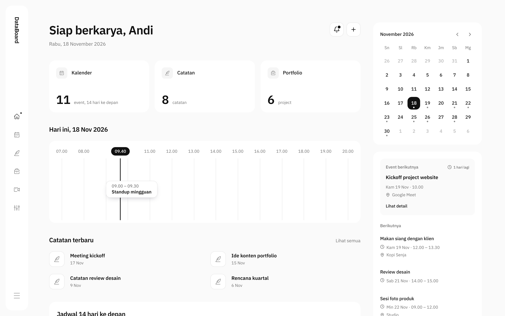

# DataBoard

**Dashboard pribadi untuk Windows: kalender, catatan, portfolio, dan rekam layar dalam satu aplikasi
yang ringan dan berjalan offline.**



## Tentang DataBoard

DataBoard adalah aplikasi desktop untuk mengatur pekerjaan sehari-hari di satu tempat: jadwal dan
pengingat, catatan meeting, daftar karya, sampai rekaman layar. Begitu dibuka, Beranda langsung
menunjukkan apa yang terjadi hari ini, event berikutnya, dan catatan terakhir yang kamu tulis.

- **Offline dan pribadi.** Semua data tersimpan di komputermu sendiri. Tidak perlu akun, tidak ada
  server, dan tidak ada pelacakan. Lihat [Kebijakan Privasi](PRIVACY.md).
- **Ringan.** Installer sekitar 5 MB. Saat jendela ditutup, DataBoard tetap berjalan di tray agar
  pengingat bisa muncul sebagai notifikasi Windows.
- **Terhubung dengan AI.** Asisten seperti Claude, ChatGPT (Codex), Gemini, Cursor, atau VS Code
  bisa membaca dan menambah data DataBoard lewat server MCP bawaan, kalau kamu mengaturnya.

## Fitur

**Beranda**

- Sapaan, ringkasan jumlah event, catatan, dan project.
- Linimasa hari ini dengan penanda waktu sekarang, kalender bulanan, event berikutnya, dan catatan
  terbaru.
- Grafik jadwal 14 hari ke depan dan menu lonceng untuk pengingat yang belum selesai.

**Kalender dan pengingat**

- Tampilan kalender bulanan atau daftar yang dikelompokkan per hari, minggu, atau bulan.
- Satu event bisa punya beberapa pengingat (10 menit, 1 jam, 1 hari, atau menit sesukamu).
- Pengingat muncul sebagai notifikasi Windows, juga saat jendela DataBoard sedang ditutup.
- Buat catatan meeting langsung dari sebuah event.

**Catatan**

- Editor WYSIWYG: judul H2 dan H3, tebal, miring, daftar, daftar centang, kutipan, kode, dan tautan.
- Tanggal, label yang bisa dikelola sendiri, sematkan di atas, dan status draf atau terbit.
- Template notulen meeting dan tautan ke event kalender.
- Butir centang bertanggal (mis. `- [ ] Kirim proposal @2026-11-20 09:00`) bisa dijadikan pengingat.
- Cari dan filter per label atau status, lalu ekspor ke Word (.docx) atau PDF.

**Portfolio**

- Project dengan cover, klien, tahun, peran, jenis, tools, tautan situs dan repo, serta deskripsi.
- Filter per jenis, tahun, atau tools, dan seret kartu untuk mengubah urutan.

**Rekam layar**

- Rekam monitor, jendela, atau tab, dengan suara komputer dan mikrofon.
- Simpan ke folder `Videos\DataBoard` atau langsung unggah ke Google Drive setelah login sekali.

**Pengaturan dan data**

- Profil, tema terang atau gelap, dua warna aksen, dan nama aplikasi.
- Jalankan otomatis saat Windows menyala dan atur pengingat bawaan.
- Backup otomatis mingguan, backup manual, pulihkan dari backup, dan ekspor ke JSON, CSV, atau
  Markdown.
- Snippet siap salin untuk menyambungkan asisten AI lewat MCP.

**Lainnya**

- Palet perintah `Ctrl+K`, `Ctrl+1` dan seterusnya untuk pindah menu, `Ctrl+N` untuk item baru.
- Pembaruan otomatis: app memberi tahu saat versi baru tersedia dan memasangnya setelah kamu setuju.

## Unduh dan pasang

1. Unduh file `.msi` terbaru dari halaman
   [Releases](https://github.com/cendysaputra/databoard/releases/latest).
2. Jalankan installer-nya. Karena installer belum ditandatangani sertifikat, Windows bisa
   menampilkan "Windows protected your PC". Klik **More info**, lalu **Run anyway**.
3. Saat pertama dibuka, isi profil singkat. Data profil hanya disimpan di komputermu.

Butuh Windows 10 atau 11. Versi web untuk pratinjau dan pemakaian di ponsel dijelaskan di bagian
[App mobile (PWA)](#app-mobile-pwa).

## Pengembangan

Bagian di bawah ini untuk yang ingin membangun atau mengubah DataBoard sendiri. Rencana kerja
lengkap ada di [PLAN.md](PLAN.md).

### Perintah

| Perintah                                                                            | Fungsi                                                                    |
| ----------------------------------------------------------------------------------- | ------------------------------------------------------------------------- |
| `npm run dev`                                                                       | Preview UI di browser (`http://localhost:5173`), data contoh di IndexedDB |
| `npm run dev:app`                                                                   | Jalan sebagai app desktop dengan SQLite                                   |
| `npm run build` / `npm run build:app`                                               | Build frontend / build installer MSI                                      |
| `npm run lint` · `npm run typecheck`                                                | ESLint + Prettier · TypeScript                                            |
| `cargo fmt --all --check` · `cargo clippy --workspace --all-targets -- -D warnings` | Cek Rust                                                                  |
| `cargo test --workspace`                                                            | Tes Rust                                                                  |
| `npm run gen:types`                                                                 | Generate tipe TypeScript dari Rust ke `src/shared/types/`                 |

### Struktur

- `src/` — frontend React. `features/` per modul, `shared/` untuk yang dipakai bersama,
  `data/` adalah satu-satunya pintu ke backend (`tauri-source` atau `browser-source`).
- `crates/core/` — SQLite, migration, dan semua logika bisnis (`domain/`).
- `src-tauri/` — shell Tauri; command tipis yang memanggil `crates/core`.
- `mcp-server/` — binary MCP (stdio) yang memakai `crates/core` yang sama.

### Mengubah sesuatu

- Tampilan: edit `src/shared/styles/tokens.css`.
- Teks UI: edit `src/shared/i18n/id.ts`.
- Schema: tambah file baru di `crates/core/migrations/` dan daftarkan di
  `crates/core/src/db/migrations.rs`. Migration yang sudah rilis tidak boleh diedit.
- Tipe data: ubah struct Rust di `crates/core/src/domain/`, lalu `npm run gen:types`.

### Rilis dan pembaruan

Versi app ada di satu tempat: `version` di `Cargo.toml` (workspace). Alur rilis:

1. Ubah `version` di `Cargo.toml`, commit.
2. `git tag vX.Y.Z` lalu `git push --tags`.
3. Workflow `.github/workflows/release.yml` membangun MSI (berisi app dan `mcp-server.exe`),
   menandatangani pembaruan, dan mengunggahnya ke GitHub Release bersama `latest.json`.

App yang terpasang mengecek `latest.json` saat dibuka dan sekali sehari, lalu menampilkan
banner "Versi baru tersedia". Pembaruan baru dipasang setelah tombolnya ditekan.

GitHub Secrets yang dibutuhkan workflow:

| Secret                               | Isi                                                     |
| ------------------------------------ | ------------------------------------------------------- |
| `TAURI_SIGNING_PRIVATE_KEY`          | Isi file private key updater (jangan pernah di-commit)  |
| `TAURI_SIGNING_PRIVATE_KEY_PASSWORD` | Password key itu; kosong bila key dibuat tanpa password |
| `DATABOARD_GOOGLE_CLIENT_ID`         | Opsional, untuk unggah ke Google Drive                  |
| `DATABOARD_GOOGLE_CLIENT_SECRET`     | Opsional, untuk unggah ke Google Drive                  |

Public key pasangannya ada di `src-tauri/tauri.conf.json` (`plugins.updater.pubkey`). Kalau
key diganti (`npx tauri signer generate -w <file>`), app yang sudah terpasang dengan key lama
tidak bisa lagi menerima pembaruan, jadi ganti hanya sebelum rilis pertama.

Build installer di komputer sendiri: set `TAURI_SIGNING_PRIVATE_KEY` (dan password-nya), lalu
`npm run build:app`. MSI belum ditandatangani dengan sertifikat code signing, sehingga Windows
SmartScreen menampilkan "Unknown publisher"; lihat catatan di awal file workflow.

### App mobile (PWA)

Build web (`npm run build`, dideploy ke Vercel lewat `vercel.json`) bisa dipasang di ponsel
sebagai app:

- **Android (Chrome):** buka URL-nya, lalu menu ⋮ → **Instal aplikasi**.
- **iPhone (Safari):** buka URL-nya, lalu **Bagikan** → **Tambah ke Layar Utama**.

Di layar selebar ponsel, sidebar diganti tab bar di bawah. Service worker (`public/sw.js`)
menyimpan semua file build, jadi app tetap terbuka tanpa koneksi; daftar file diisi saat build
oleh plugin `precache` di `vite.config.ts`. Data tersimpan di IndexedDB ponsel itu sendiri dan
tidak tersinkron dengan app desktop. Rekam layar tidak tampil di browser yang tidak mendukungnya
(semua browser ponsel).

### Google Drive (unggah rekaman)

Unggah rekaman ke Google Drive hanya ada di app desktop dan butuh OAuth client milik
pembuat build (tipe **Desktop app**, scope `drive.file`). Kredensialnya dibaca dari
environment, saat build atau saat dijalankan:

```
DATABOARD_GOOGLE_CLIENT_ID=xxxx.apps.googleusercontent.com
DATABOARD_GOOGLE_CLIENT_SECRET=...
```

Tanpa keduanya, app tetap jalan dan halaman Rekam layar menampilkan "Google Drive belum
diatur". Jangan commit nilainya; untuk rilis, simpan sebagai GitHub Secrets. Token login
pengguna disimpan di Windows Credential Manager, bukan di database.

## Lisensi

[MIT](LICENSE)
