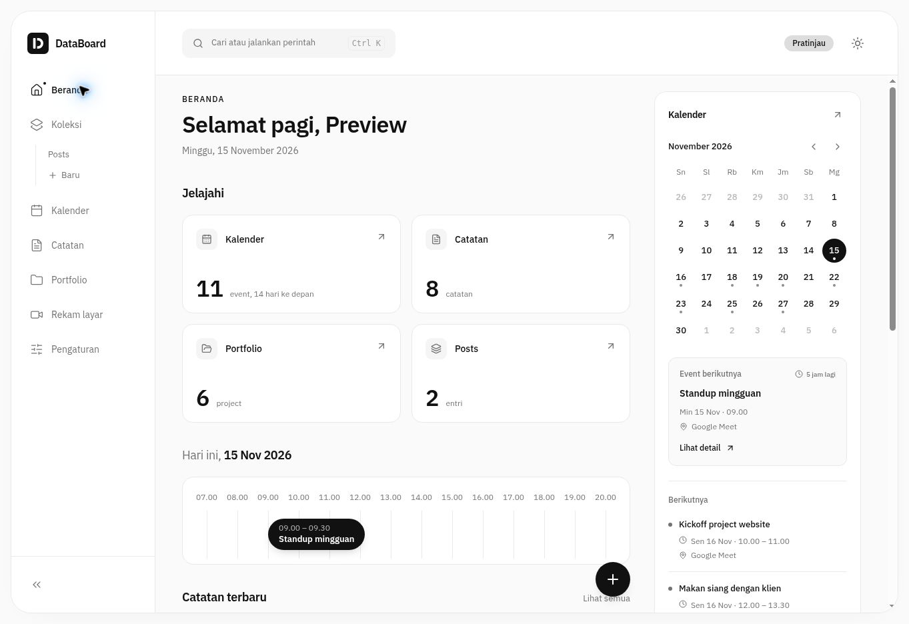

# DataBoard visual refresh

The interface uses white surfaces, a #fafafa canvas, black primary actions, gray
secondary accents and IBM Plex Sans. Character artwork and illustrated page
banners have been removed; further illustration work is deferred.

The CMS logo and favicon use a minimal split D monogram. Sidebar icons share a
1.5px outline style without menu backgrounds. The current page is indicated by a
small dot at the top-right of its icon, alongside the accessible current-page state.
The same marker follows its icon in expanded, collapsed and mobile layouts.

The original routes, forms, queries, persistence, exports and theme controls are
retained. Existing installations using the previous default purple/orange pair
receive a one-time upgrade to the neutral pair. Custom palettes remain available.

## Verification

- `npm run build` and `npm run lint`.
- Browser review of desktop and 320px/768px layouts; no page or calendar panel overflow.
- Existing note filtering, editor/export menu and command palette.
- Calendar navigation, selected-day timeline and event links.
- Calendar month navigation and selected-day timeline verified (2 events on the selected day, 1 on today).
- One-time palette upgrade and preservation of custom choices checked with a targeted runtime assertion.
- Native app icon files regenerated from the monochrome SVG.
- Native Tauri build and native notification/backup integrations were not run.

## Integration review after profile and recording features

The merge at `9b537cf` retained the approved palette, split D logo, thin outline
navigation, active-page state, and compact calendar panel. Its production
entry JavaScript and stylesheet filenames matched a local build of that commit.
The new profile, onboarding, recorder and Drive integrations were retained.

The remaining inconsistency was the native application icon, which still used
the old bar mark. Native SVG, PNG, ICO and ICNS files now derive from the CMS
favicon. The recording navigation icon uses the same 1.5px outline family,
without an extra dot in its glyph. Recording status indicators remain unchanged.

Source changes appear in the website after a deployment and page reload.
An installed desktop application needs a new native build to receive them;
pulling the repository does not replace an existing installed executable.
